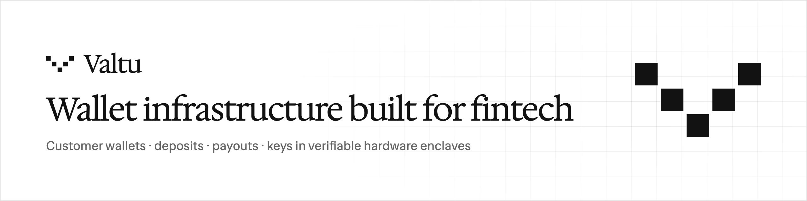

<picture>
  <source media="(prefers-color-scheme: dark)" srcset="./banner-dark.png">
  
</picture>

**Custodial wallet infrastructure for fintechs.** Give every customer a wallet, credit deposits only when they're final, send payouts your own team approves, and keep keys in hardware enclaves you can verify yourself.

[Website](https://valtu.io) · [Docs](https://valtu.io/docs) · [API guide](https://valtu.io/docs/api) · [Security](https://valtu.io/security) · [Status](https://status.valtu.io) · [Blog](https://valtu.io/blog) · [Talk to us](https://valtu.io/contact)

### Quick start

```bash
npm install @valtu/wallet-kit
```

```ts
import { Valtu, depositAddress } from "@valtu/wallet-kit";

const valtu = Valtu.fromEnv();                              // your signed API key
const wallet = await valtu.wallets.forCustomer("cus_42");   // one wallet, an address on every network
console.log(depositAddress(wallet, "tron"));                // show this to your customer

await valtu.transfers.create({                              // a payout: your policies decide who approves
  walletId: PAYOUT_WALLET_ID,                               // your payout wallet
  asset: "USDT-TRC20",
  amount: await valtu.assets.toBaseUnits("USDT-TRC20", "25.50"),
  to: "TQ…",
  externalId: "payout_981",                                 // retries never pay twice
});
```

Start free on testnets, with the same API you'll use live: **[create a test workspace](https://valtu.io/app/signup)**.

### What you get

| | |
| --- | --- |
| **Wallets** | One call per customer: an EVM address for Ethereum, BNB Chain, Polygon, Base and Lisk, plus Tron and Bitcoin |
| **Deposits and sweeps** | Credited only when final, reorganizations handled, swept to treasury on a schedule |
| **Payouts and approvals** | Policies on amount, destination and velocity; approvals with passkeys; up to 100 per batch |
| **Gas station** | Network fees paid from a gas wallet; Tron energy rental |
| **Screening** | KYT with your own Elliptic, Chainalysis, Blockaid or Webacy account |
| **Payment links** | Hosted stablecoin checkouts |
| **Webhooks** | Every step signed (Ed25519 and HMAC-SHA256), retried, and reconcilable |

**Networks:** Ethereum · BNB Chain · Polygon · Base · Lisk · Tron · Bitcoin, with USDT and USDC.

### Verify, don't trust

Keys are generated and used only inside hardware enclaves. The enclave image is built reproducibly and its measurement is published, so anyone can ask the running service to prove what it is (`GET /v1/attestation`) and check it with `verifyAttestation` from the SDK. What's done and what isn't yet, including the external audit, is listed openly on the [security page](https://valtu.io/security).

### Packages

| Package | Version | |
| --- | --- | --- |
| [`@valtu/wallet-kit`](https://www.npmjs.com/package/@valtu/wallet-kit) | [](https://www.npmjs.com/package/@valtu/wallet-kit) | Node.js and TypeScript SDK: signed client, webhook verification, attestation checks. Zero dependencies. |

### Contact

Sales and partnerships: [valtu.io/contact](https://valtu.io/contact) · Support: support@valtu.io · Security reports: security@valtu.io ([policy](https://valtu.io/docs/security#reporting))
